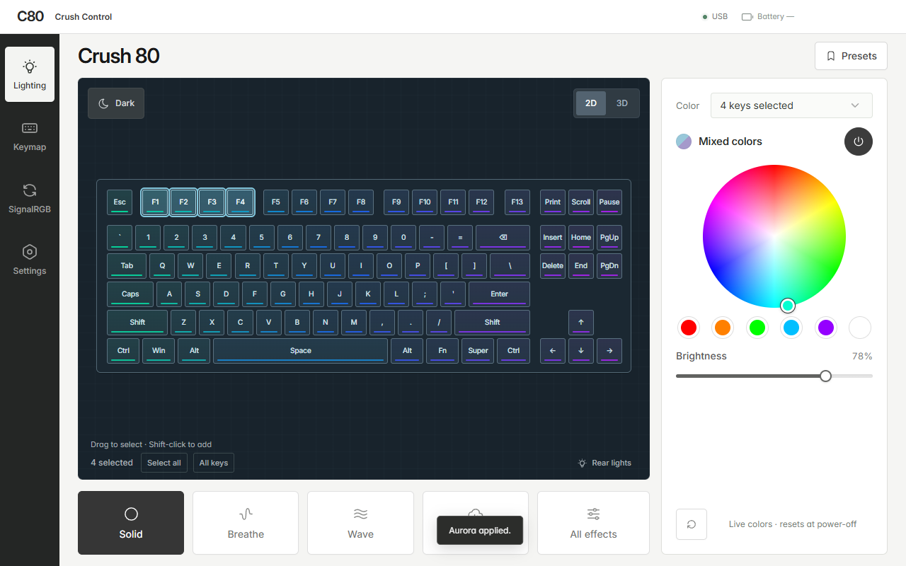

# Crush Control

A Windows lighting app for the **tested WOBKEY Crush 80 Pro**, by [mi0ir](https://mi0ir.com).

[Visit the app page](https://mizu121.github.io/crush-control-releases/) · [Download and release notes](https://github.com/mizu121/crush-control-releases/releases) · [Star on GitHub](https://github.com/mizu121/crush-control-releases) · [Support development](https://buymeacoffee.com/mi0ir) · [Report an issue](https://github.com/mizu121/crush-control-releases/issues)

## Features

- Select keys with a click, Shift-click or a drag; set a color or leave them off.
- Save named PC presets, with WASD Only, FPS Focus, Neon Split, Aurora and more as starting points.
- Use the default 2D editor or enable the optional silver 3D keyboard preview.
- Sync rear-foot colors with the whole-board picker on supported firmware. Heartbeat/status lights remain separate.
- Experimental picker and preset control through a locally linked 2.4 GHz dongle.
- USB VIA key mapping with backup and readback verification.
- Tray presets and Windows Bluetooth battery readings, clearly marked **last known** when stale.
- App update checks, release notes, verified downloads and an explicit **Restart and install** action.

## Check compatibility first

**Wrong-model firmware can brick your keyboard.** This project has been validated on one specific Crush 80 Pro hardware/firmware combination. Other Crush 80 variants and Pro revisions have not been validated. A product name or matching USB ID is not enough.

Stock firmware provides whole-board VIA lighting and USB key mapping. Per-key RGB and rear-color sync require the exact tested combined v1.04 firmware, CRC `0x5566DDF2`, with the expected PKRG v2 capabilities. **Settings → Firmware setup** checks compatibility. The app does not include, distribute or flash firmware, and installing the app does not add per-key support to stock firmware.

Experimental wireless controls use the locally linked `320F:5088` receiver. Link the tested board and its paired receiver over USB first. Do not re-pair a linked receiver to an unsupported board; moving USB ports may require linking again. Bluetooth RGB control is not implemented. Battery information comes from Windows' Bluetooth report, not live dongle or charging telemetry.

## Install and update

1. Read the release notes and compatibility limits, then download the Windows x64 installer from [Releases](https://github.com/mizu121/crush-control-releases/releases).
2. Quit Crush Control, SignalRGB and other keyboard lighting controllers before initial installation. Closing Crush Control's window leaves its tray process running; use **Quit** or **Ctrl+Q**.
3. Install the updater-enabled app manually once. Later, use **Settings → App updates** to check, download and choose when to restart. Checks do not silently download or install. App updates keep the existing PC presets and receiver association and never flash keyboard firmware.

This beta has **no Windows Authenticode certificate** yet, so Windows may show an unknown-publisher or SmartScreen warning. The app's separate release signature verifies later updates; it does not replace Windows signing or establish trust in a first installer from an untrusted source.

Per-key frames are live RAM state and reset on keyboard power-off. Saved PC presets can be reapplied. **Clear Keys** clears the main keys, not the rear feet or heartbeat.

## About this repository

This repository contains the app page, installers and release information. The application source and private release-signing key remain private. It contains no keyboard firmware or flashing tools. Source archives generated by GitHub contain this public website, not the desktop application's source.

This is experimental evaluation software. See the terms and third-party notices included with the installer. This project is independent and is not endorsed or sponsored by WOBKEY. Compatibility, sleep/wake behavior and long-term reliability on additional boards are not established.

## Support the project

If Crush Control is useful to you, [give this repository a star](https://github.com/mizu121/crush-control-releases). Stars help other keyboard owners find the project and show support for its development.

You can also [leave mi0ir a tip on Buy Me a Coffee](https://buymeacoffee.com/mi0ir) to support development and testing. Tips are optional and do not unlock extra features.

You can also [report a bug](https://github.com/mizu121/crush-control-releases/issues) or share the app page. Please include your keyboard revision and app version in bug reports; never post personal information or firmware dumps.

Developer: [mi0ir](https://mi0ir.com).
